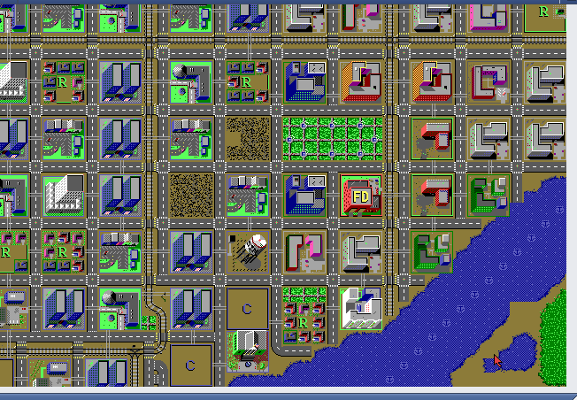
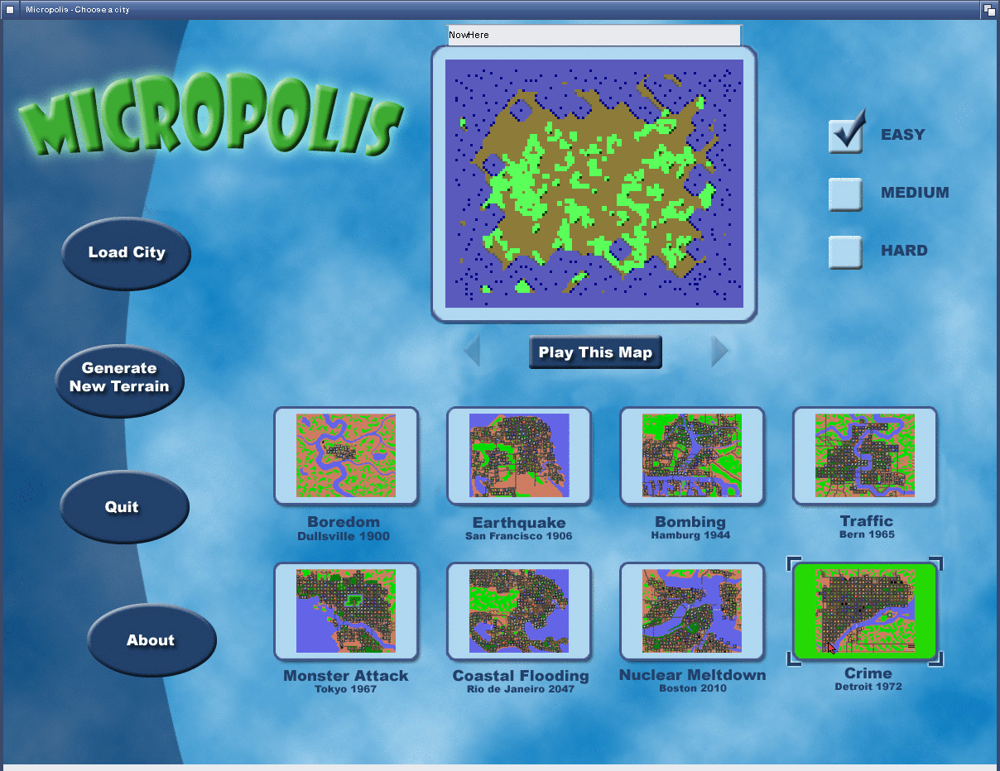
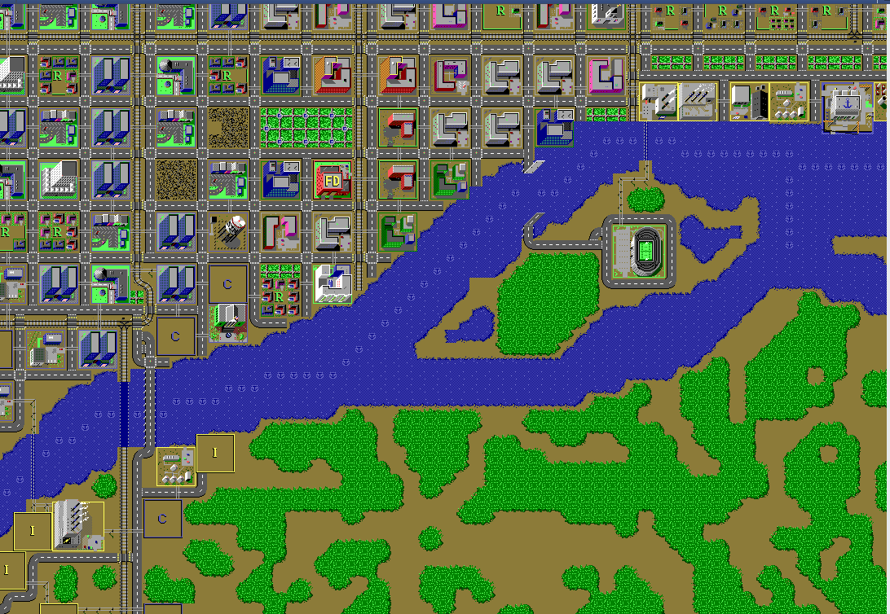

# Micropolis

**SimCity Classic, the open-source release, native on the Amiga.**

  

  
  

Captured from this build running on AmigaOS.

Lay out roads, zone your city, balance the budget and survive the monster. Micropolis is the GPL release of Will Wright and Don Hopkins's original SimCity, and this is a native Intuition, GadTools and AHI front end for it on AmigaOS 3.x, with every tool, the pie menus, the eight scenarios and load/save of .cty cities.

## What you need

A 68040 or 68060 with an FPU, AmigaOS 3.2 or later, an RTG card (15-bit or more), AHI.

Everything the game needs comes in its drawer, including the scenario cities.

## Controls

| Key | Does |
|---|---|
| Mouse | Build, pick tools (hold for the pie menu) |
| Arrows | Scroll the map |
| F9 | Screen mode |
| Window gadgets | Budget, evaluation, graphs, map |

## What works

- The whole classic game: scenarios, tools, disasters, budget, graphs, overview map
- Runs on the Workbench when it is an RTG screen, or opens its own 640x480 16-bit screen
- Saves in PROGDIR:Saves

## Not in this build yet

- RTG only: there is no AGA or 8-bit display

## Building

The Amiga build, its make file and what was changed for the 68k are described in [AMIGA_PORT.md](AMIGA_PORT.md).

## Credits and licence

MicropolisCore by Don Hopkins; Micropolis for AROS by Tomasz Staniak ([upstream](https://github.com/SimHacker/MicropolisCore)). Licence: GPL 3.

Amiga port by The AmiCradle Team.

The original project's README is [README.upstream.md](README.upstream.md).
